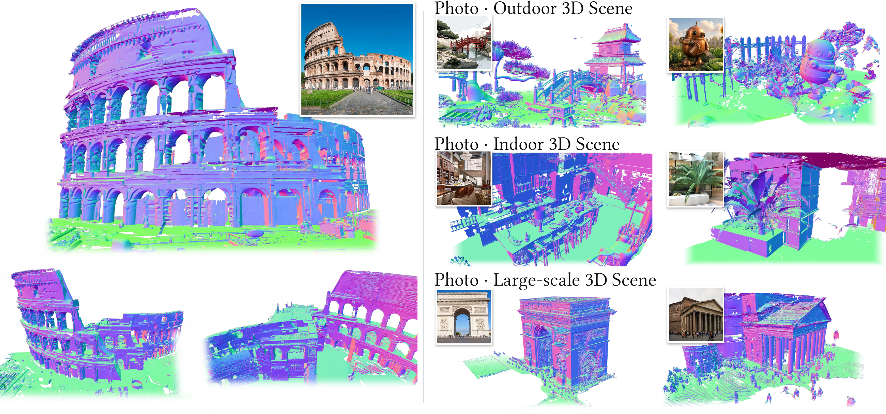

<p align="center">
  
</p>

<h1 align="center">Building Rome from a Single Image</h1>

<p align="center">
  <a href="https://arxiv.org/abs/2610.08790"></a>
  <a href="https://build-rome.github.io/"></a>
  <a href="https://huggingface.co/AppliedIntuitionResearch/BuildRome"></a>
  <a href="LICENSE"></a>
</p>

<p align="center">
  <a href="https://domejiraphon.github.io/">Jiraphon Yenphraphai</a> ·
  <a href="https://fangli333.github.io/">Fang Li</a> ·
  <a href="https://hk.linkedin.com/in/tianshuo-xu-04463336b">Tianshuo Xu</a> ·
  <a href="https://deppmeng.github.io/">Depu Meng</a> ·
  <a href="https://www.linkedin.com/in/quentin-herau-phd-38378b140">Quentin Herau</a> ·
  <a href="https://www.linkedin.com/in/yihan-hu96">Yihan Hu</a> ·
  <a href="https://raymond-yeh.com/">Raymond A. Yeh</a> ·
  <a href="https://zhanwei.site/">Wei Zhan</a>
</p>

<p align="center">
  <a href="assets/teaser/teaser.png"></a><br>
  <em>Complete 3D meshes from a single image: Colosseum views and diverse indoor, outdoor, and large-scale reconstructions.</em>
</p>

Generate a metric 3D scene mesh from one photograph. MoGe-3 estimates the scene's
geometry and camera parameters, and a fine-tuned TRELLIS.2 model generates
adaptive scene chunks with latent outpainting. The chunks grow with distance
and are stitched into a scene mesh. This repository contains the inference code.

**Built with DINOv3.**

## 🔥 News

- The paper is available on [arXiv](https://arxiv.org/abs/2610.08790).
- Code and fine-tuned checkpoints are released; the checkpoints are on [Hugging Face](https://huggingface.co/AppliedIntuitionResearch/BuildRome).

## 📋 Table of Contents

- [Installation](#installation)
- [Checkpoints](#checkpoints)
- [Getting Started](#getting-started)
- [Citation](#citation)
- [License](#license)
- [Acknowledgments](#acknowledgments)

<a id="installation"></a>
## 🛠️ Installation

**Requirements:** Linux, Conda, an NVIDIA CUDA GPU, and a CUDA-compatible compiler
toolchain. The setup script creates a Python 3.10 environment with PyTorch 2.6.0
and CUDA 12.4 wheels. Its sparse and rendering extensions require GPU support;
the inference entry point uses CUDA.

```bash
git clone https://github.com/Applied-Intuition-Open-Source/BuildRome.git
cd BuildRome
. ./setup.sh --new-env --basic --flash-attn --nvdiffrast --cumesh --flexgemm --o-voxel
```

`o-voxel` is bundled in `o-voxel/` and installed from that directory. The setup
script also installs upstream dependencies and uses `sudo apt` for system
packages.

**Required external assets:**

| Asset | Public source | Use |
| --- | --- | --- |
| TRELLIS.2 base weights | [microsoft/TRELLIS.2-4B](https://huggingface.co/microsoft/TRELLIS.2-4B) | SS and SLat denoisers and shape decoder. |
| TRELLIS sparse-structure decoder | [microsoft/TRELLIS-image-large](https://huggingface.co/microsoft/TRELLIS-image-large) | Occupancy decoding. |
| DINOv3 features | [facebook/dinov3-vitl16-pretrain-lvd1689m](https://huggingface.co/facebook/dinov3-vitl16-pretrain-lvd1689m) | Image conditioning. |
| MoGe-3 | [MoGe code](https://github.com/microsoft/MoGe) and [Ruicheng/moge-3-vitg](https://huggingface.co/Ruicheng/moge-3-vitg) | Metric depth and camera estimation. |
| Rome fine-tuned deltas | [AppliedIntuitionResearch/BuildRome](https://huggingface.co/AppliedIntuitionResearch/BuildRome) | SS and SLat LoRA adapters and conditioning branches. |

Models are obtained from their upstream sources on first use. Follow the
upstream access requirements, accept any applicable terms, and authenticate to
Hugging Face where required. These external assets retain their own licenses.

MoGe-3's sparse refiner needs PyTorch 2.8 or newer, so install it in a separate
environment:

```bash
conda create -n moge3 python=3.10
conda activate moge3
pip install torch==2.8.0 torchvision==0.23.0 --index-url https://download.pytorch.org/whl/cu128
pip install git+https://github.com/microsoft/MoGe.git
```

Pass that environment's Python interpreter to inference with
`--moge3-python /path/to/envs/moge3/bin/python`.
Alternatively, supply a compatible precomputed depth pack with `--depth-pack`;
the format is documented in `build_rome/modules/lifting.py`.

<a id="checkpoints"></a>
## 📦 Checkpoints

The fine-tuned weights are on Hugging Face at
[AppliedIntuitionResearch/BuildRome](https://huggingface.co/AppliedIntuitionResearch/BuildRome), under CC BY-NC 4.0
(non-commercial use only):

| Model | File | Contents | Size |
| --- | --- | --- | --- |
| SS, occupancy | `ss_delta.safetensors` | LoRA adapters and depth-lift / clearance branches, 115M params | 438 MiB |
| SLat, shape | `slat_delta.safetensors` | LoRA adapters and depth-lift branch, 66M params | 251 MiB |

```bash
hf download AppliedIntuitionResearch/BuildRome --local-dir checkpoints
```

The deltas are combined with the separately downloaded TRELLIS.2 base weights,
whose upstream terms continue to apply.

<a id="getting-started"></a>
## 🚀 Getting Started

After installing the dependencies and downloading the checkpoints, run it on
any photograph (indoor or outdoor; no example images are included):

```bash
python inference/image_to_scene.py --image path/to/photo.jpg \
    --ss-ckpt checkpoints/ss_delta.safetensors --slat-ckpt checkpoints/slat_delta.safetensors --out results/
```

The same pipeline as a Python object, loading the models once for many images:

```python
from build_rome import ScenePipeline

pipe = ScenePipeline.from_pretrained("AppliedIntuitionResearch/BuildRome")  # or the two local files
scene = pipe("photo.jpg")                 # SceneOutput
scene.save("results/photo")               # scene.glb, layout_bands.json, layout_topview.png, spiral.mp4
mesh = scene.mesh                         # trimesh.Scene, metric, glTF Y-up, camera at the origin
```

`from_pretrained` also takes a directory holding the two delta files or a
Hugging Face repo id with them (`ScenePipeline.from_pretrained("org/repo")`),
plus `moge3_python=` for a separate MoGe-3 environment. The call accepts a path
or a PIL image and the band options below as keyword arguments
(`band_near_m=9.0`, `max_inflated_voxels=100_000`, ...).

The run writes `results/<image-stem>/` containing:

- `scene.glb`: metric scene mesh, glTF Y-up, with the camera at the origin looking along -Z.
- `layout_bands.json` and `layout_topview.png`: the depth bands and chunk layout.
- `spiral.mp4`: an orbit rendering next to the input image.

Use `--no-spiral-video` to skip the video. MoGe-3 depth packs are cached locally
by image content and can be reused between runs. On one A100 80GB, a street scene
reaching 98 m (4 depth bands, 15 chunks) peaks at 15.8 GiB of allocated GPU
memory and takes about 6 min.

| Option | Default | Purpose |
| --- | --- | --- |
| `--band-near-m` | 9 | Use native 3 m chunks up to this depth. |
| `--band-growth` | 2 | Increase chunk size in more distant bands. |
| `--band-min-coverage` | 0.05 | Drop distant bands with insufficient image coverage. |
| `--band-count`, `--band-min-depth-m` | Automatic | Override the number or reach of depth bands. |
| `--no-cross-band` | Cross-band outpainting enabled | Generate bands without reusing overlap latents. |
| `--max-inflated-voxels` | 100000 | Lower the shape-decoding cap if GPU memory is insufficient. |

<a id="citation"></a>
## 📝 Citation

```bibtex
@article{yenphraphai2026rome,
  title   = {Building Rome from a Single Image},
  author  = {Yenphraphai, Jiraphon and Li, Fang and Xu, Tianshuo and Meng, Depu and Herau, Quentin and Hu, Yihan and Yeh, Raymond A. and Zhan, Wei},
  journal = {arXiv preprint arXiv:2610.08790},
  year    = {2026}
}
```

<a id="license"></a>
## ⚖️ License

- **Original project code and project-authored modifications:** licensed under
  [Creative Commons Attribution-NonCommercial 4.0 International (CC BY-NC 4.0)](LICENSE).
  Non-commercial use, sharing, and adaptation are permitted subject to the
  license's attribution and other conditions. Commercial use of these
  contributions requires separate permission from the rights holders.
- **Rome checkpoints:** released on [Hugging Face](https://huggingface.co/AppliedIntuitionResearch/BuildRome) under CC BY-NC 4.0,
  non-commercial use only. Their training data and upstream models are listed
  in [NOTICE](NOTICE) and on the model card.
- **Third-party code, dependencies, and upstream weights:** retain their
  separate licenses and notices. CC BY-NC 4.0 does not replace or restrict the
  original upstream license grants. See [NOTICE](NOTICE) for their attribution
  and terms.
- **Branding and the teaser figure:** not covered by this code license. No
  trademark rights are granted.

<a id="acknowledgments"></a>
## 🙏 Acknowledgments

This codebase builds on [TRELLIS.2](https://github.com/microsoft/TRELLIS.2),
[TRELLIS](https://github.com/microsoft/TRELLIS),
[MoGe](https://github.com/microsoft/MoGe), and
[DINOv3](https://github.com/facebookresearch/dinov3) (built with DINOv3), with dependencies including
[CuMesh](https://github.com/JeffreyXiang/CuMesh),
[FlexGEMM](https://github.com/JeffreyXiang/FlexGEMM),
[nvdiffrast](https://github.com/NVlabs/nvdiffrast), and
[utils3d](https://github.com/EasternJournalist/utils3d).
The released weights are trained on scenes from
[SAGE-10k](https://huggingface.co/datasets/nvidia/SAGE-10k) (NVIDIA, Apache-2.0) and scenes
generated with [Infinigen](https://github.com/princeton-vl/infinigen) (Princeton, BSD-3-Clause).
We thank the authors for making their work available.
